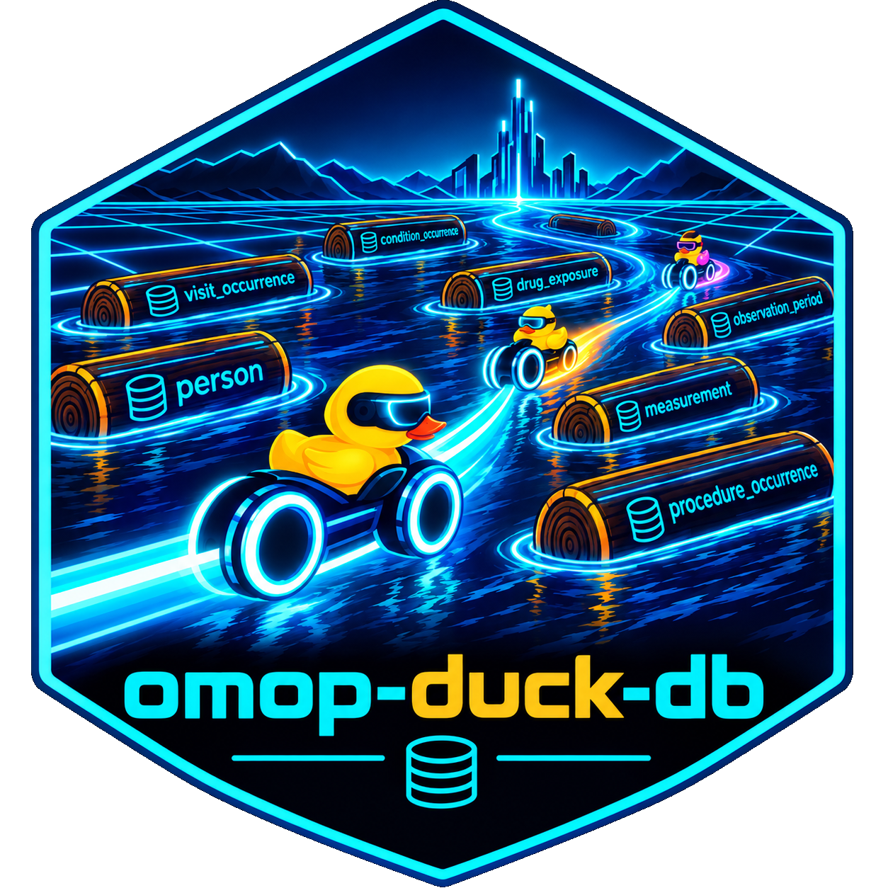

<!-- README.md is generated from README.Rmd. Edit README.Rmd, then run: quarto render README.Rmd (or scripts/render_readme.R). Do not edit README.md by hand. -->

# omop-duck-db <a href="https://jkylearmstrong.github.io/omop-duck-db/"></a>

<!-- badges: start -->

[](https://github.com/jkylearmstrong/omop-duck-db/actions/workflows/ci.yml)
[](https://github.com/jkylearmstrong/omop-duck-db/actions/workflows/test-coverage.yaml)
[](https://github.com/jkylearmstrong/omop-duck-db/actions/workflows/python-test-coverage.yaml)
[](https://app.codecov.io/gh/jkylearmstrong/omop-duck-db)
[](https://github.com/jkylearmstrong/omop-duck-db/pkgs/container/omop-duck-db)
<!-- badges: end -->

Tools for building an [OMOP Common Data
Model](https://ohdsi.github.io/CommonDataModel/) (CDM) v5.4 database in
[DuckDB](https://duckdb.org/), loading the OHDSI Athena vocabulary,
mapping PCORnet-format source data into the CDM, and running cohort,
feature and quality workflows on it. Provided as an R package
(`omopduckdb`) and a Python package (`omop_etl`, also importable as
`omop_duck_db`) that share the same schema and concept-mapping SQL.

**Scope.** General-purpose mapping/ETL tooling and a small fabricated
sample fixture. This repository does not ingest, store or process
protected or identifiable data; real use happens against your own data
infrastructure.

## Install

``` r
# install.packages("remotes")
remotes::install_github("jkylearmstrong/omop-duck-db")
```

``` bash
pip install omop-duck-db            # or: pip install 'omop-duck-db[ml]' for the ML dependencies
pip install 'omop-duck-db[postgres-embedded]'   # optional: PostgreSQL inside Python, see testing/postgres-in-python.md
```

Working inside this repository with R? `.Rprofile` activates `renv`; run
`renv::restore()`, or set `RENV_CONFIG_AUTOLOADER = FALSE` / use
`Rscript --no-init-file` to use your system library.

## Quick start

``` r
library(omopduckdb)

build_schema("omop_cdm.duckdb")                                    # empty CDM v5.4 schema
load_vocabulary("path/to/athena_download", "omop_cdm.duckdb")      # Athena vocabulary
etl_pcornet("path/to/pcornet_extract", "omop_cdm.duckdb")          # PCORnet -> CDM

con <- omop_connect("omop_cdm.duckdb")                             # also attaches a sibling central vocabulary
cohort <- define_study_cohort(con, visit_type = "inpatient", min_age = 18, table_name = "cohort")
```

``` python
from omop_etl import build_schema, etl_pcornet, load_vocabulary, omop_connect, define_study_cohort
import duckdb

con = duckdb.connect("omop_cdm.duckdb"); build_schema(con); con.close()
load_vocabulary("path/to/athena_download", "omop_cdm.duckdb")
etl_pcornet("path/to/pcornet_extract", "omop_cdm.duckdb")          # a second full run needs overwrite=True

con = omop_connect("omop_cdm.duckdb")
cohort = define_study_cohort(con, visit_type="inpatient", min_age=18, table_name="cohort")
```

Command-line equivalents:
`Rscript inst/scripts/etl_pcornet.R --source-dir ...` and
`python -m omop_etl.build_omop_cdm --source-dir ...`. `etl_pcornet()`
refuses to load into a database that already holds ETL output (it would
duplicate every row); pass `overwrite = TRUE` to empty the CDM tables
first.

## Docker image

Every version tag publishes an image to GitHub Container Registry (not
Docker Hub); the build runs both test suites. The badge above shows the
latest build and links to the package page.

``` bash
docker pull ghcr.io/jkylearmstrong/omop-duck-db:latest
```

## Guides

The long-form documentation lives in vignettes (the website’s *Articles*
menu).

| Topic | Guide |
|----|----|
| **Build and operate** |  |
|   Build the database, refresh the vocabulary, central vocabulary, custom and Usagi mappings, run the tests, sync large files | `vignette("database_and_mapping")` |
|   Keep site databases in a PostgreSQL that runs inside Python (no install, no admin rights) and check the DuckDB <-> PostgreSQL round trip | [`testing/postgres-in-python.md`](testing/postgres-in-python.md) |
| **Cohorts and features** |  |
|   Study cohorts, comorbidity, measurement sanitisation, features, Table 1, reconciliation, the shipped eDERRI cohort definitions | `vignette("study_cohorts_and_features")` |
|   Add your own person-level features (R and Python), and fit them once for use across sites | `vignette("study_features")` |
|   Circe evaluation, cohort reconciliation, bundles, feature ablation and the DQD catalog for a downstream study | `vignette("study_design_tools")` |
| **Clinical tools and multi-site work** |  |
|   Risk scores, wide tables, phenotypes, consortium federation, calibration, decision curves | `vignette("clinical_tools_and_consortium")` |
|   Small-cell suppression, CONSORT counts, site summary packages | `vignette("disclosure_and_site_packages")` |
| **Machine learning and OHDSI** |  |
|   scikit-learn, omop-learn, OHDSI PLP / DeepPLP, tidymodels | `vignette("ml_bridge")` |
|   Benchmark features, deep-learning datasets, DGX Spark, Oracle | `vignette("deep_learning_and_benchmarks")` |
|   What was checked against the official OHDSI tools, and what was not | `vignette("ohdsi_integration")` |
| **Cloud and demos** |  |
|   Run the diabetes cohort on public BigQuery data (CMS SynPUF); the runnable BigQuery-to-DuckDB check is `inst/examples/bigquery_duckdb_roundtrip.qmd` | `vignette("bigquery_synthetic_demo")` |
| **Reproducibility and status** |  |
|   Reproducing the delivered manuscript, decisions that move the numbers | `vignette("reproducing_the_manuscript")` |
|   What is claimed, verified and planned; architecture notes and the R/Python parity table | `vignette("status_and_roadmap")` |

## Works with the OHDSI ecosystem

The package is built to sit beside the standard OMOP tools, not replace
them. Status by tool (the evidence is in
`vignette("ohdsi_integration")`; `vignette("status_and_roadmap")` says
what is claimed versus verified):

| Status | Tools |
|----|----|
| **Compared against the official tool** (DuckDB, DatabaseConnector 8.0.0) | [CirceR](https://github.com/OHDSI/CirceR) + CohortGenerator (cohort definitions), [FeatureExtraction](https://github.com/OHDSI/FeatureExtraction) (visit counts, custom covariates), [PatientLevelPrediction](https://github.com/OHDSI/PatientLevelPrediction) (`getPlpData`, study population, `runPlp`), [DeepPatientLevelPrediction](https://github.com/OHDSI/DeepPatientLevelPrediction) (an MLP trained on `as_plp_data()` output), [CohortMethod](https://github.com/OHDSI/CohortMethod) (study population and an unadjusted odds ratio), [CohortConstructor](https://github.com/OHDSI/CohortConstructor) (concept and demographic cohorts), [DataQualityDashboard](https://github.com/OHDSI/DataQualityDashboard), Achilles, PhenotypeLibrary, CohortDiagnostics, via [HADES](https://github.com/OHDSI) DatabaseConnector; [omop-learn](https://github.com/clinicalml/omop-learn) (`DuckDBBackend` against the real classes) |
| **Works, partly checked** | [ATLAS](https://github.com/OHDSI/Atlas) 2.x: `scripts/atlas/` imports the shipped Circe JSON and has WebAPI render SQL (verified on WebAPI 2.14; not a generation check). FeatureExtraction’s Charlson index is **not** equivalent to the package’s. |
| **Not covered by any check** | ATLAS 3 (UI never run), [Data2Evidence](https://github.com/OHDSI/Data2Evidence), [Phenelope](https://github.com/OHDSI/Phenelope) (needs an LLM), [OHDSI GIS / Gaia](https://github.com/OHDSI/GIS) (PostgreSQL/PostGIS). Reasons in `vignette("ohdsi_integration")`. |

Where the package overlaps an OHDSI tool (cohort engine, DQD catalog,
Achilles subset, Table 1) it covers a subset and says so; prefer the
official tool for anything you publish.

## Repository layout

- `inst/extdata/5.4/duckdb/*.sql` – CDM v5.4 DDL; the schema source of
  truth for **both** languages.
- `inst/sql/*.sql` – DuckDB macros shared by both ETLs (ID hashing, date
  parsing, ancestry). Concept resolution itself is written out in each
  loader.
- `R/` – the R package. `python/omop_etl/` – the Python package, closely
  mirroring it (some features are language-specific; see
  `vignette("status_and_roadmap")`). `python/omop_duck_db/` re-exports
  `omop_etl`.
- `inst/scripts/` – command-line wrappers; `inst/cohorts/` – shipped
  Circe cohort definitions; `inst/examples/`, `scripts/` – worked
  examples and repository helper scripts; `vignettes/` – the guides
  above.

## Things to know before you rely on results

- **Age.** `define_study_cohort()` computes age in completed years. The
  old calendar-year method is still available as
  `age_method = "year_difference"`, but it is deprecated: it admits
  people younger than `min_age`.
- **Disclosure.** Aggregate helpers suppress counts from 1 to
  `min_cell_count - 1` (default 11) and blank what could be recovered
  from them by subtraction. Only the duplicate/overlap helpers and the
  site-summary export were audited; treat other helpers’ output as
  pre-suppression. Details: `vignette("disclosure_and_site_packages")`.
- **Vocabulary.** Athena downloads omit CPT4 concept names (AMA
  licence); until the licensed tool is run, CPT4 procedures map to
  concept 0. A few source fields (e.g. admission source) are not mapped
  yet.
- **Not run live.** The BigQuery sync, Oracle cohort-SQL translation and
  Oracle transfers are unit-tested only; the DGX Spark GPU path is
  untested on the device. R behaviour on production-size data is less
  field-tested than Python’s.

See `NEWS.md` for changes and `vignette("status_and_roadmap")` for
architecture notes and the R/Python parity table.
